# agentic-ds-template


A [Copier](https://copier.readthedocs.io) template for data science and ML projects that coding
agents build with you. One command gives you a working, tested baseline pipeline, a strict
quality gate, and Claude Code and Codex set up to turn a written plan into a verified pull request.

With the optional **ticket factory** (in development), the project runs as a dark software
factory, one where no person drives each step: you write GitHub issues and release them with
a label, agents triage, implement and verify them, and a project board shows each ticket
moving to a verified pull request that you merge.
[How the factory works](#ticket-factory-from-issue-to-pull-request).

- **Ticket factory:** issues labeled `factory:ready` move through a GitHub project board via
  triage, implementation and cross-vendor verification to a pull request you merge. Labels and
  board set themselves up when the project is copied. In development.
- **Plan delivery:** `task deliver` runs a plan unattended under a completion guard, gets a
  cross-vendor review and opens a PR, within cost budgets.
- **Three architectures:** simple modules, Kedro-style pipeline graphs, or hexagonal layers, each
  enforced by import contracts.
- **A virtual uv workspace:** apps under `apps/`, shared libraries under `packages/`,
  a generic evaluation protocol and an 80 % branch coverage gate.
- **Modern tooling:** uv, Task, Ruff, ty, import-linter, prek, pytest, Sphinx, all behind one
  `task check`.
- **Agents with guardrails:** hooks, permissions and sandboxing shared by Claude Code and Codex.
- **Production path:** MLflow tracking, FastAPI, Streamlit, Docker and Azure via Pulumi, all
  optional.
- **Updatable:** pull later template versions without touching your code.

Every feature is listed in the [feature index](docs/features.md).

## Quick start

1. **Install the prerequisites:** [git](https://git-scm.com), [uv](https://docs.astral.sh/uv/)
   and [Task](https://taskfile.dev). uv provides Python and every other tool.

2. **Generate a project** and answer the questions:

   ```bash
   uvx copier copy --trust gh:florian-drawitsch/agentic-ds-template my-project
   ```

   `--trust` lets Copier run `git init` and `uv lock` after rendering. To accept every default
   without prompts:

   ```bash
   uvx copier copy --trust --defaults --data project_name=my-project --data github_owner=<you> gh:florian-drawitsch/agentic-ds-template my-project
   ```

3. **Install and verify:**

   ```bash
   cd my-project && task setup && task check
   ```

   `task setup` syncs the locked environment, installs the git hooks and registers a Jupyter
   kernel. `task check` runs lint, types, import contracts and tests.

4. **Run the baseline pipeline:** put a CSV with a `target` column into
   `data/01_raw/input.csv`, then:

   ```bash
   task my_project:run
   ```

   With MLflow, `task mlflow` shows the tracked run at `http://127.0.0.1:5000`.

5. **Open the project in Claude Code or Codex** and trust it. Hooks, permissions and the pinned
   plugin marketplace load automatically. Fill `docs/context/` so agents know the problem and
   the data.

6. **Optionally run the ticket factory:** answer `factory=yes` in step 2, push the project to
   GitHub and run `task factory:init`. See [Ticket factory](#ticket-factory-from-issue-to-pull-request).

## Ticket factory: from issue to pull request

> In development (ADR-0033). Labels, the board, status and the dispatch decision work today.
> Triage, implementation and verification by agents arrive in the next stages.

The factory turns GitHub issues into verified pull requests without a person driving each
step. Issue labels hold the state, and a GitHub project board shows it. A deterministic
controller, not a model, picks the next action. A human still merges every pull request.

```mermaid
---
config:
  themeCSS: >-
    .row-rect-odd path, .row-rect-even path, marker circle { fill: none !important; }
    .edgePaths path, .flowchart-link, .relation, .transition, .relationshipLine, marker path, marker circle { stroke: #868e96 !important; }
    circle.state-start, circle.state-end { fill: #868e96 !important; stroke: #868e96 !important; }
    rect.actor, rect.note, rect[class^=activation], polygon.labelBox { fill: none !important; stroke: #868e96 !important; }
    line[class^=actor-line], line.loopLine, line[class^=messageLine], path[class^=messageLine] { stroke: #868e96 !important; }
    text.actor, text.actor tspan, .messageText, .noteText, .noteText tspan, .labelText, .labelText tspan, .loopText, .loopText tspan, text.text { fill: #868e96 !important; }
---
flowchart LR
  classDef default fill:none,stroke:#868e96,stroke-width:1px,color:#868e96
  classDef blue fill:none,stroke:#2f81f7,stroke-width:2px,color:#2f81f7
  classDef red fill:none,stroke:#e5534b,stroke-width:2px,color:#e5534b
  linkStyle default stroke:#868e96

  issue([Issue]) -->|maintainer labels| ready[Ready]
  ready --> triage[triage]:::blue
  triage -->|unclear| info[Needs info]:::red
  info --> ready
  triage --> accepted[Accepted]
  accepted --> deliver[deliver]:::blue
  deliver --> verify[independent verification]:::blue
  verify --> verified[Verified]
  verify -->|stuck or protected path| human[Needs human]:::red
  verified --> merge([human merge])
```



Blue steps run unattended. Red columns wait for a person.

**Set it up in a generated project:**

1. Answer `factory=yes` when copying. The question appears with GitHub CI and both agent
   harnesses, because the verifier must be the other vendor.
2. Allow `gh` to manage projects, once per machine:

   ```bash
   gh auth refresh -s project
   ```

3. Push the project to GitHub, then create the labels and the board:

   ```bash
   task factory:init
   ```

   `init` creates the seven `factory:*` labels and a board named `<repository> factory` with
   one Status column per state, links it to the repository and writes its URL to
   `factory.toml`. Commit that change. `copier copy` and `task setup` run the same step and
   skip it with a note while the repository, the scope or write access is missing, so copying
   into a clone of an existing GitHub repository sets everything up at once.

**Work with it:**

1. Write an issue with a clear goal and acceptance criteria.
2. Add the label `factory:ready`. Only labels set by users with write access count.
3. `task factory:status` shows the issues per state, spend against the caps and the next
   action. `task factory:tick` prints that action without changing anything.
4. `task factory:sync` mirrors manual label changes into the board.

`factory.toml` limits the work: one issue in progress, at most three verified pull requests
waiting for a merge, USD 20 per day and USD 100 per sprint. Pull requests that touch protected
paths, such as agent settings, CI or `factory.toml`, always go to a human. The generated
`docs/guides/factory.md` describes every label and board column.

## Build features with agents

```mermaid
---
config:
  themeCSS: >-
    .row-rect-odd path, .row-rect-even path, marker circle { fill: none !important; }
    .edgePaths path, .flowchart-link, .relation, .transition, .relationshipLine, marker path, marker circle { stroke: #868e96 !important; }
    circle.state-start, circle.state-end { fill: #868e96 !important; stroke: #868e96 !important; }
    rect.actor, rect.note, rect[class^=activation], polygon.labelBox { fill: none !important; stroke: #868e96 !important; }
    line[class^=actor-line], line.loopLine, line[class^=messageLine], path[class^=messageLine] { stroke: #868e96 !important; }
    text.actor, text.actor tspan, .messageText, .noteText, .noteText tspan, .labelText, .labelText tspan, .loopText, .loopText tspan, text.text { fill: #868e96 !important; }
---
flowchart LR
  classDef default fill:none,stroke:#868e96,stroke-width:1px,color:#868e96
  classDef blue fill:none,stroke:#2f81f7,stroke-width:2px,color:#2f81f7
  linkStyle default stroke:#868e96

  idea([Idea]) --> brainstorm[brainstorm]
  brainstorm --> plan[/plan file/]
  plan --> deliver[task deliver]:::blue
  deliver --> review[cross-vendor review]:::blue
  review --> gate{task check?}
  gate -->|fails| deliver
  gate -->|passes| pr([GitHub PR])
  pr --> fix[task deliver:fix-pr]:::blue
  fix --> pr
```



Blue steps run unattended.

1. **Brainstorm:** ask the agent to use the `brainstorm` skill. It explores requirements and
   design options. Durable decisions become ADRs in `docs/adr/`.
2. **Plan:** the `write-plan` skill writes a test-first plan with `- [ ]` items to
   `docs/plans/YYYY-MM-DD-<topic>.md`. Commit it.
3. **Deliver:** run `task deliver` and pick the plan, the implementing agent, the reviewer and
   the review budget in the menus. `task deliver -- --preview` shows the menus without starting
   anything.
   - The run works in `.worktrees/<topic>` on a `feat/<topic>` branch.
   - A completion guard keeps the agent working until every item is ticked and `task check`
     passes.
   - The other vendor's agent reviews the change once, read-only. Required findings are fixed
     with a regression test.
   - The run pushes the branch and opens a PR. It never merges and never requests human
     reviewers.
4. **Review and merge** the PR yourself. To fix Codex review comments on it, run
   `task deliver:fix-pr -- <number>`.

Runs stop at USD 2 per round and USD 10 per run by default, wait out usage limits for up to 48
hours, and continue with `task deliver:resume`. `task deliver:status -- --all-worktrees` shows
every run with token usage and estimated cost.

Inside an agent session, the `deliver` skill does the same without leaving the chat.

### Skills

| Skill | Use it to |
| --- | --- |
| `brainstorm` | Explore requirements and design trade-offs before planning |
| `write-plan` | Write a test-first implementation plan in `docs/plans/` |
| `deliver` | Execute a plan to a verified PR; resume runs; repair PR findings |
| `cross-review` | Have the other vendor's agent review a change, read-only |
| `github-create-pr` | Create or update a PR that follows the PR template |
| `mermaid` | Draw diagrams in one checked house style |
| `template-update` | Pull a newer template version and merge conflicts by file ownership |
| `agents-md` | Audit or update AGENTS.md against the code, tasks and ADRs |
| `implement-feature`, `debug`, `execute-plan`, `request-review`, `wrap-feature` | Test-driven work, debugging, step-wise execution, in-session review, finishing a branch ([Superpowers](https://github.com/obra/superpowers)) |

### Guardrails

The same hooks run in Claude Code and Codex:

- **Session start:** branch, uncommitted changes, latest plan and active runs.
- **Before each tool call:** blocks pip, `.env` access, hand edits of `uv.lock`, force pushes and
  skipped git hooks, and says what to do instead.
- **After each edit:** formats Python with Ruff and checks Mermaid diagrams.
- **On stop:** the delivery completion guard.

Unattended runs also scrub provider tokens, restrict network access to package registries, and
scan published commits for secrets with gitleaks.

## Choose the project shape

The most important questions:

| Question | Choices (default first) |
| --- | --- |
| `architecture` | simple, pipeline, hexagonal |
| `interfaces` | none, FastAPI REST API, Streamlit dashboard |
| `config` | Hydra, TOML with dataclasses |
| `tracking` | MLflow with a local SQLite store, none |
| `infrastructure` | none, Azure with Pulumi |
| `agent_harnesses` | Claude Code and Codex, either one, none |
| `factory` | no, yes: the ticket factory; needs GitHub CI and both harnesses |

Optional context questions seed `docs/context/` and AGENTS.md. All questions are in the
[feature index](docs/features.md#copier-questions).

## What you get

```text
my-project/
├── AGENTS.md, CLAUDE.md          agent instructions: commands, layout, rules, definition of done
├── Taskfile.yml, taskfiles/      every command as a task
├── pyproject.toml, uv.lock       workspace, dev tools, Ruff, ty, pytest, coverage
├── .pre-commit-config.yaml       git hooks run by prek
├── .claude/, .codex/             settings, hooks, roles, Codex app actions
├── .github/                      CI, Renovate, PR template
├── data/01_raw … 09_tracking/    numbered data layers, git-ignored
├── docs/                         Sphinx site: context, method, ADRs, plans, guides
├── notebooks/                    exploration, outputs stripped on commit
├── scripts/agent/                hook and delivery scripts
├── apps/<package>/               pyproject.toml, Taskfile.yml, optional Dockerfile
│   ├── src/<package>/            baseline pipeline in the chosen architecture
│   ├── conf/                     Hydra or TOML configuration
│   └── tests/{unit,integration}/
├── packages/                     shared workspace libraries
└── infra/                        Pulumi stack for Azure (optional)
```

Every project has an 80 % branch coverage gate and a generic evaluation protocol in
`docs/method/evaluation-protocol.md`. Runtime dependencies follow the selected tools.
Apps never import each other. Shared libraries belong in `packages/`.
The generated development guide explains how to add another app.

## Everyday commands

| Command | Does |
| --- | --- |
| `task --list` | Show every task |
| `task check` | Merge gate: hooks, types, import contracts, tests |
| `task test-fast -- apps/<app>/tests/unit` | Focused tests without coverage |
| `task <app>:run -- <overrides>` | Run the pipeline, with Hydra overrides |
| `task <app>:sweep -- key=a,b` | Run every combination of overrides |
| `task mlflow`, `task <app>:api`, `task <app>:dashboard` | Tracking UI, REST API, dashboard |
| `task docs:serve` | Live documentation |
| `task deliver` | Deliver a committed plan as a PR |
| `task deliver:status` | Delivery runs, tokens and cost |
| `task factory:status` | Ticket factory issues per state, spend and next action |
| `task update-template` | Pull the latest template version |

The [feature index](docs/features.md#tasks) lists every task, including Docker and Azure.

## Deploy to Azure

With `infrastructure=azure`, `infra/` holds a Pulumi stack: container registry, managed
identity, Container Apps environment, and optionally a scheduled pipeline job, an API app, a
file share, Key Vault and an MLflow workspace.

```bash
task infra:test
```

```bash
task infra:bootstrap STATE_ACCOUNT=<unique-name>
```

```bash
task infra:init && task infra:up && task infra:release
```

`infra:test` needs no Azure account. The generated `docs/guides/deployment.md` covers the
one-time setup and the GitHub Actions deployment with OpenID Connect.

## Keep projects current

```bash
task update-template
```

- Copier three-way merges template-owned files and never touches `apps/`, `packages/`,
  `notebooks/`, `docs/context/`, `docs/method/` or `README.md`.
- In an agent session, the `template-update` skill runs the update, resolves conflicts by file
  ownership, regenerates `uv.lock` and runs `task check`, without committing.
- Skills update separately: bump `marketplace_ref` with
  `uvx copier update --trust --data marketplace_ref=<tag>`.

## Documentation

- [Feature index](docs/features.md): every feature, task and option.
- [Architecture](docs/design/architecture.md): repository layout, question model, file
  ownership, test strategy.
- [Decision records](docs/adr/index.md): why the template works the way it does.
- [project plugin](plugins/project/README.md): skills and delivery setup in other repositories.

## Contributing

This repository holds the template (`copier.yml`, `template/`) and the plugin marketplace
(`catalog.toml`, `plugins/`).

```bash
task setup
```

```bash
task check
```

- `task build` regenerates the marketplace files and plugin manifests from `catalog.toml`.
- `task test-e2e` renders a pairwise set of projects and runs each one's `task check`.
- `task dev` registers this working copy as a local marketplace in Claude Code and Codex.
- `task eval` scores the skills against a no-plugin baseline. It spends model tokens.
- `task factory:init` sets up the ticket factory for this repository: labels, the board and its
  URL in the root `factory.toml`. `task factory:status` and `task factory:tick` work as in
  generated projects. The root `factory.toml` also protects the delivery guard, the factory
  itself, ADRs and the catalog, so changes there always go to a human.

Rules for contributors and agents are in [AGENTS.md](AGENTS.md).

## License

[MIT](LICENSE)
