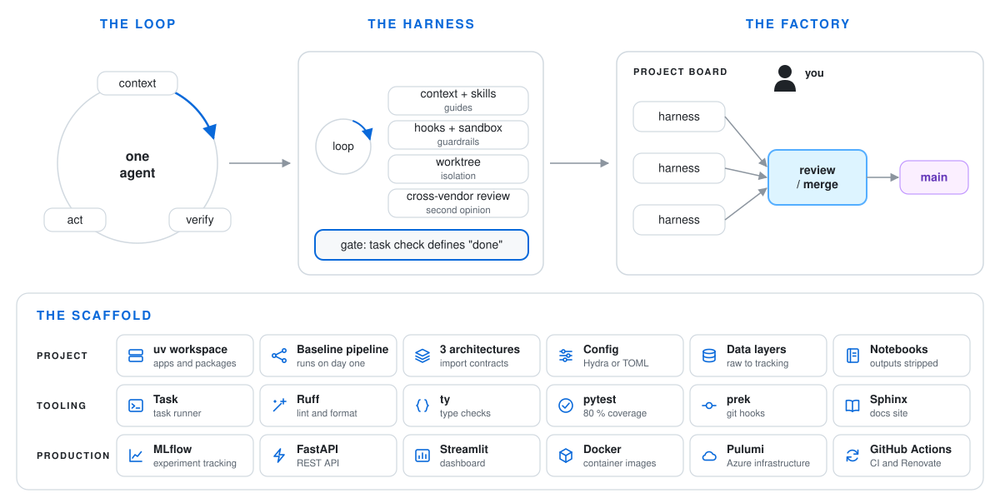
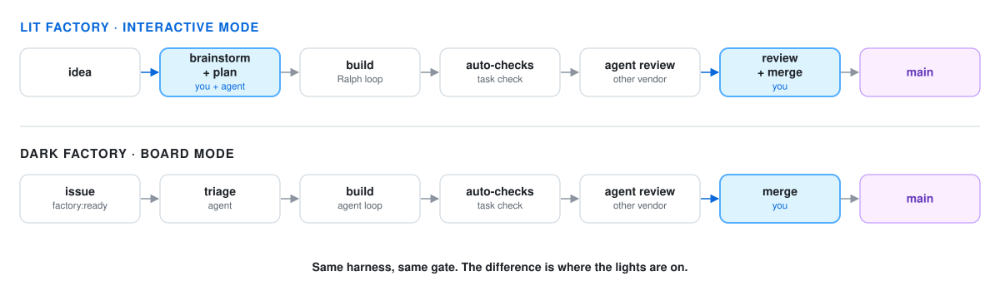

# agentic-ds-template


Copier template for agentic development of production-grade AI and ML solutions.

It combines:

- **Agent harness:** context, skills, guardrail hooks and quality gates that Claude Code and
  Codex share, so agents can work on the project unsupervised.
- **Lit factory with spec-driven development:** you shape the design with an agent in your
  IDE, then a Ralph loop implements the plan until every item is done and `task check`
  passes, followed by a cross-vendor review and a pull request.
- **Dark factory with GitHub board integration:** labeled issues move across a project board
  through triage, implementation and cross-vendor verification to a pull request you merge.
- **Modern Python scaffolding:** a uv workspace with Ruff, ty, pytest and import contracts,
  checked by one `task check` gate.
- **Production path:** MLflow tracking, FastAPI, Streamlit, Docker and Azure via Pulumi, each
  optional.
- **Template updates:** pull new template versions without touching your code.

## Template features

<picture>
  <source media="(prefers-color-scheme: dark)" srcset="docs/assets/harness-and-factory-dark.svg">
  
</picture>

- **Loop:** one agent reads context, acts, verifies and repeats. A Ralph loop keeps it going
  until the work is done, not until the agent decides it is.
- **Harness:** the loop with guides that steer it (project context, skills) and sensors that
  check it (hooks, `task check`, a review by the other vendor's agent). `task check` defines
  what "done" means.
- **Factory:** many harnessed loops, fed by the project board and drained through one gate:
  your merge. You are the outer loop. You decide what gets built and what ships.
- **Scaffold:** the codebase every loop works in. A clear layout, architecture contracts and
  tests make agent mistakes cheap to catch.

## Factory modes

<picture>
  <source media="(prefers-color-scheme: dark)" srcset="docs/assets/lit-and-dark-factory-dark.svg">
  
</picture>

- **Lit factory, interactive mode:** you work with Claude Code or Codex in your IDE or app and
  shape the design with the skills. The harness then builds it unattended.
  [Lit factory](#lit-factory).
- **Dark factory, board mode:** agents run from the issue to the pull request. You write the
  issue and merge the result. [Dark factory](#dark-factory).

Both modes end at the same gate: nothing merges without you.

## Quick start

1. **Install the prerequisites:** [git](https://git-scm.com), [uv](https://docs.astral.sh/uv/)
   and [Task](https://taskfile.dev). uv provides Python and every other tool.

2. **Generate a project** and answer the questions:

   ```bash
   uvx copier copy --trust gh:florian-drawitsch/agentic-ds-template my-project
   ```

   `--trust` lets Copier run `git init` and `uv lock` after rendering. To accept every default
   without prompts:

   ```bash
   uvx copier copy --trust --defaults --data project_name=my-project --data github_owner=<you> gh:florian-drawitsch/agentic-ds-template my-project
   ```

3. **Install and verify:**

   ```bash
   cd my-project && task setup && task check
   ```

   `task setup` syncs the locked environment, installs the git hooks and registers a Jupyter
   kernel. `task check` runs lint, types, import contracts and tests.

4. **Run the baseline pipeline:** put a CSV with a `target` column into
   `data/01_raw/input.csv`, then:

   ```bash
   task my_project:run
   ```

   With MLflow, `task mlflow` shows the tracked run at `http://127.0.0.1:5000`.

5. **Open the project in Claude Code or Codex** and trust it. Hooks, permissions and the pinned
   plugin marketplace load automatically. Fill `docs/context/` so agents know the problem and
   the data.

6. **Optionally turn on board mode:** answer `factory=yes` in step 2, push the project to
   GitHub, run `task factory:init`, then `task factory:loop` locally or `task factory:secrets`
   for GitHub Actions. See [Dark factory](#dark-factory).

## Lit factory

Interactive mode follows spec-driven development. Open the project in Claude Code or Codex,
in the terminal, your IDE or the desktop app. The skills load from the pinned marketplace.

1. **Brainstorm:** ask the agent to use the `brainstorm` skill. It explores requirements and
   design options. Durable decisions become decision records in `docs/adr/`.
2. **Plan:** the `write-plan` skill writes a test-first plan with `- [ ]` items to
   `docs/plans/YYYY-MM-DD-<topic>.md`. Commit it.
3. **Deliver:** run `task deliver` and pick the plan, the implementing agent, the reviewer and
   the review budget in the menus. `task deliver -- --preview` shows the menus without starting
   anything.
   - The run works in `.worktrees/<topic>` on a `feat/<topic>` branch.
   - A Ralph loop keeps the agent working until every item is ticked and `task check` passes.
   - The other vendor's agent reviews the change once, read-only. Required findings are fixed
     with a regression test.
   - The run pushes the branch and opens a pull request. It never merges and never requests
     human reviewers.
4. **Review and merge** the pull request yourself. To fix Codex review comments on it, run
   `task deliver:fix-pr -- <number>`.

Runs stop at USD 2 per round and USD 10 per run by default, wait out usage limits for up to 48
hours, and continue with `task deliver:resume`. `task deliver:status -- --all-worktrees` shows
every run with token usage and estimated cost. Inside an agent session, the `deliver` skill
does the same without leaving the chat.

## Dark factory

Board mode turns GitHub issues into verified pull requests without a person driving each
step. Issue labels hold the state, and a GitHub project board shows it. A deterministic
controller, not a model, picks the next action. A person still merges every pull request.

**Set it up**, in a generated project or in this repository:

1. Generated projects: answer `factory=yes` when copying. The question appears with GitHub CI
   and both agent harnesses, because the verifier must be the other vendor. This repository
   already has the root `factory.toml`, the tasks and the workflow.
2. Allow `gh` to manage projects, once per machine:

   ```bash
   gh auth refresh -s project
   ```

3. Push to GitHub, then create the labels and the board:

   ```bash
   task factory:init
   ```

   `init` creates the `factory:*` and `priority:*` labels and a board named
   `<repository> factory`, and links it to the repository. The board is found by that name
   under the repository's owner, so no URL is stored and every fork gets its own board. In
   generated projects, `copier copy` and `task setup` run the same step and skip it with a
   note while the repository, the scope or write access is missing.

4. Choose where it runs:
   - **Locally**, with your existing `gh`, `claude` and `codex` logins and no secrets. It
     runs while your machine and the loop run:

     ```bash
     task factory:loop
     ```

   - **In GitHub Actions**, every 30 minutes with your machine off. Set three repository
     secrets step by step; the command opens each page in the browser and stores each value
     without printing it:

     ```bash
     task factory:secrets
     ```

     It sets `FACTORY_GH_TOKEN` (a classic token with the `repo`, `project` and `read:org` scopes, or the
     token of your `gh` login), the Claude login (`CLAUDE_CODE_OAUTH_TOKEN` from
     `claude setup-token`, using your subscription, or `ANTHROPIC_API_KEY`) and
     `OPENAI_API_KEY`. Until they exist, the workflow skips each run with a notice. Public
     repositories pay no Actions minutes; private ones on the Free plan spend about 1,500
     of their 2,000 monthly minutes on idle polling, so lengthen the interval if other
     workflows need minutes too, or run locally.

5. Protect `main`: require a pull request and the CI check. The factory never merges. GitHub
   does not let you approve your own pull requests, so with a token of your own account,
   require no approvals, or give the token to a separate machine account.

**Work with it:**

1. Write an issue with a clear goal and acceptance criteria.
2. Release it: add the label `factory:ready`, or move its card to **Ready** on the board. Only
   users with write access count. A moved card becomes `factory:ready` at the next tick.
3. Each tick takes one step: triage, implementation, repair or verification. The card moves
   from Ready through Accepted, In progress and In review to Verified. You review and merge
   the pull request.
4. `task factory:status` shows the issues per state, spend against the caps and the next
   action. `task factory:tick -- --dry-run` prints that action without changing anything.

**The board** has one column per state:

| Column | Meaning |
| --- | --- |
| Ready | Released by a maintainer |
| Needs info | Triage needs more information from you |
| Accepted | Triaged and queued |
| In progress | An agent is implementing it |
| In review | Pull request open, the other vendor's agent is verifying it |
| Verified | All checks passed, waiting for your merge |
| Needs human | Stopped, a person must decide |

Three views filter it: **Board** shows every column, **Backlog** shows tickets not started yet,
and **Needs attention** shows tickets waiting for you. Order the queue with the labels
`priority:high`, `priority:medium` and `priority:low`. Labels drive the factory: a card moved to
Ready becomes `factory:ready`, and a card moved to any other column returns to its label's
column at the next tick.

**Limits** live in `factory.toml`: one issue in progress, at most three verified pull requests
waiting for a merge, USD 20 per day and USD 100 per calendar week. Pull requests that touch
protected paths, such as agent settings, CI or `factory.toml`, always go to a person. The
generated `docs/guides/factory.md` describes every label and column.

## Harness

The same harness runs in Claude Code and Codex.

**Guides** steer agents before they act:

- `AGENTS.md` and `docs/context/` describe the commands, the layout, the rules, the problem and
  the data.
- Import contracts define which modules may use which, in the chosen architecture.
- Skills hold reusable procedures:

| Skill | Use it to |
| --- | --- |
| `brainstorm` | Explore requirements and design trade-offs before planning |
| `write-plan` | Write a test-first implementation plan in `docs/plans/` |
| `deliver` | Execute a plan to a verified pull request; resume runs; repair review findings |
| `cross-review` | Have the other vendor's agent review a change, read-only |
| `github-create-pr` | Create or update a pull request that follows the template |
| `mermaid` | Draw diagrams in one checked house style |
| `template-update` | Pull a newer template version and merge conflicts by file ownership |
| `agents-md` | Audit or update AGENTS.md against the code, tasks and decision records |
| `implement-feature`, `debug`, `execute-plan`, `request-review`, `wrap-feature` | Test-driven work, debugging, step-wise execution, in-session review, finishing a branch ([Superpowers](https://github.com/obra/superpowers)) |

**Sensors** check what agents produce:

- **Session start:** reports the branch, uncommitted changes, the latest plan and active runs.
- **Before each tool call:** blocks pip, `.env` access, hand edits of `uv.lock`, force pushes
  and skipped git hooks, and says what to do instead.
- **After each edit:** formats Python with Ruff and checks Mermaid diagrams.
- **On stop:** the Ralph loop's completion check.
- **`task check`:** lint, types, import contracts and tests with 80 % branch coverage.
- **Cross-vendor review:** Claude Code, Codex and Gemini check each other's changes.

Unattended runs also scrub provider tokens, restrict network access to package registries, and
scan published commits for secrets with gitleaks.

## Scaffold

The most important questions:

| Question | Choices (default first) |
| --- | --- |
| `architecture` | simple, pipeline, hexagonal |
| `interfaces` | none, FastAPI REST API, Streamlit dashboard |
| `config` | Hydra, TOML with dataclasses |
| `tracking` | MLflow with a local SQLite store, none |
| `infrastructure` | none, Azure with Pulumi |
| `agent_harnesses` | Claude Code, Codex and Gemini (headless on macOS), any subset |
| `factory` | no, yes: board mode; needs GitHub CI and two harnesses |

Optional context questions seed `docs/context/` and AGENTS.md. All questions are in the
[feature index](docs/features.md#copier-questions).

```text
my-project/
├── AGENTS.md, CLAUDE.md          agent instructions: commands, layout, rules, definition of done
├── Taskfile.yml, taskfiles/      every command as a task
├── pyproject.toml, uv.lock       workspace, dev tools, Ruff, ty, pytest, coverage
├── .pre-commit-config.yaml       git hooks run by prek
├── .claude/, .codex/             settings, hooks, roles, Codex app actions
├── .github/                      CI, Renovate, PR template
├── data/01_raw … 09_tracking/    numbered data layers, git-ignored
├── docs/                         Sphinx site: context, method, decisions, plans, guides
├── notebooks/                    exploration, outputs stripped on commit
├── scripts/agent/                hook and delivery scripts
├── apps/<package>/               pyproject.toml, Taskfile.yml, optional Dockerfile
│   ├── src/<package>/            baseline pipeline in the chosen architecture
│   ├── conf/                     Hydra or TOML configuration
│   └── tests/{unit,integration}/
├── packages/                     shared workspace libraries
└── infra/                        Pulumi stack for Azure (optional)
```

Every project has a generic evaluation protocol in `docs/method/evaluation-protocol.md`.
Apps never import each other. Shared libraries belong in `packages/`. The generated
development guide explains how to add another app.

**Everyday commands:**

| Command | Does |
| --- | --- |
| `task --list` | Show every task |
| `task check` | Merge gate: hooks, types, import contracts, tests |
| `task test-fast -- apps/<app>/tests/unit` | Focused tests without coverage |
| `task <app>:run -- <overrides>` | Run the pipeline, with Hydra overrides |
| `task <app>:sweep -- key=a,b` | Run every combination of overrides |
| `task mlflow`, `task <app>:api`, `task <app>:dashboard` | Tracking UI, REST API, dashboard |
| `task docs:serve` | Live documentation |
| `task deliver` | Deliver a committed plan as a pull request |
| `task deliver:status` | Delivery runs, tokens and cost |
| `task factory:status` | Board mode issues per state, spend and next action |
| `task update-template` | Pull the latest template version |

The [feature index](docs/features.md#tasks) lists every task, including Docker and Azure.

## Deployment

With `infrastructure=azure`, `infra/` holds a Pulumi stack: container registry, managed
identity, Container Apps environment, and optionally a scheduled pipeline job, an API app, a
file share, Key Vault and an MLflow workspace.

```bash
task infra:test
```

```bash
task infra:bootstrap STATE_ACCOUNT=<unique-name>
```

```bash
task infra:init && task infra:up && task infra:release
```

`infra:test` needs no Azure account. The generated `docs/guides/deployment.md` covers the
one-time setup and the GitHub Actions deployment with OpenID Connect.

## Updates

```bash
task update-template
```

- Copier three-way merges template-owned files and never touches `apps/`, `packages/`,
  `notebooks/`, `docs/context/`, `docs/method/` or `README.md`.
- In an agent session, the `template-update` skill runs the update, resolves conflicts by file
  ownership, regenerates `uv.lock` and runs `task check`, without committing.
- Skills update separately: bump `marketplace_ref` with
  `uvx copier update --trust --data marketplace_ref=<tag>`.

## Documentation

- [Feature index](docs/features.md): every feature, task and option.
- [Architecture](docs/design/architecture.md): repository layout, question model, file
  ownership, test strategy.
- [Decision records](docs/adr/index.md): why the template works the way it does.
- [project plugin](plugins/project/README.md): skills and delivery setup in other repositories.

## Contributing

This repository holds the template (`copier.yml`, `template/`) and the plugin marketplace
(`catalog.toml`, `plugins/`).

```bash
task setup
```

```bash
task check
```

- `task build` regenerates the marketplace files and plugin manifests from `catalog.toml`.
- `task test-e2e` renders a pairwise set of projects and runs each one's `task check`.
- `task dev` registers this working copy as a local marketplace in Claude Code and Codex.
- `task eval` scores the skills against a no-plugin baseline. It spends model tokens.
- `task security` lints the workflows with zizmor and audits the locked dependencies. CI also
  scans new commits for secrets with gitleaks.
- Board mode develops this repository too: `task factory:init`, `factory:loop`,
  `factory:secrets` and `.github/workflows/factory.yml` work as in generated projects. The
  root `factory.toml` also protects the delivery guard, the factory itself, decision records
  and the catalog, so changes there always go to a person.

Rules for contributors and agents are in [AGENTS.md](AGENTS.md).

## License

[MIT](LICENSE)
