# ADR-0032: Run an opt-in ticket factory from issue labels

- **Status:** Proposed
- **Date:** 2026-11-18

## Context

`deliver` turns a plan into a verified pull request, and `fix-pr` repairs review findings on it
(ADR-0027, ADR-0028). A human still picks the ticket, writes the plan and starts each run. A
showcase should show tickets moving from a GitHub board to verified pull requests without a
human starting each step: a "software factory".

Research in November 2026 on public factories and incident reports found:

- **State in GitHub, dispatch without a model.** Working factories keep all state in issue
  labels and comments, and each agent run handles one stage and stops. One team replaced a
  model-driven dispatcher after it started runs for work that did not exist. Dispatch finishes
  open work before it starts new work.
  ([addyosmani/factory](https://github.com/addyosmani/factory),
  [coleam00/dark-factory-experiment](https://github.com/coleam00/dark-factory-experiment))
- **No board trigger.** Project board events (`projects_v2_item`) are webhook-only. They cannot
  start a GitHub Actions workflow
  ([gh-aw #25336](https://github.com/github/gh-aw/issues/25336)).
- **The writer never grades its own work.** Verifiers run in a fresh context and do not read the
  implementer's plan. StrongDM keeps acceptance scenarios outside the codebase as a holdout set,
  after agents learned to pass narrow tests
  ([Willison](https://simonwillison.net/2026/Feb/7/software-factory/)).
- **Human merge stays common.** Most factories keep merging manual. A fully unattended factory
  was abandoned after three months because the codebase degraded
  ([awesome-software-factories](https://github.com/varun1505/awesome-software-factories)).
- **Issue text is an attack path.** In 2026, prompt injection through issue titles and comments
  leaked secrets from several agent actions, among them `claude-code-action` before v1.0.94 and
  Cline's triage bot ([Clinejection](https://adnanthekhan.com/posts/clinejection/)). The
  "Rule of Two" says an agent session may hold at most two of: untrusted input, access to
  secrets, the ability to change external state
  ([Willison](https://simonw.substack.com/p/new-prompt-injection-papers-agents)). GitHub's own
  agentic workflows keep the agent read-only and apply its writes in a separate checked job
  ([gh-aw architecture](https://github.github.com/gh-aw/introduction/architecture/)).
- **Cost varies widely.** Repeat runs of one task varied up to 30 times in cost, and models
  underestimate their own usage ([briefing](https://chadgrant.github.io/dark-factories/)).
- **Scrum agents are immature.** Public scrum-agent projects are small and unstable. Working
  factories use a priority queue with limits on work in progress, plus scheduled reports.

`deliver` already covers several of these: cross-vendor review, an outer controller that owns
every GitHub write, a network allowlist, credential scrubbing and cost caps. Missing are a
dispatcher, an admission rule for tickets, holdout checks, protection of the factory's own
rules and limits on work in progress.

Some sources are secondary write-ups. The incident details should be checked against the
primary disclosures before this record is accepted.

## Decision

### Packaging

- A new `factory` plugin in this marketplace, separate from `project`. It works in Claude Code
  and Codex (ADR-0017) and ships under the same version tag (ADR-0018).
- `plugins/factory/skills/factory/` holds the skill, the triage role in `assets/` and
  `scripts/factory.py`, a stdlib-only controller. Projects get a flat copy in `scripts/agent/`,
  like `deliver.py` (ADR-0022).
- The controller calls `deliver.py` run kinds. It does not reimplement planning, delivery,
  review or repair.
- A new Copier question `factory` (default no) appears only with `ci=github` and both
  harnesses, because verification needs the other vendor. It renders `factory.toml`,
  `taskfiles/factory.yml`, `.github/workflows/factory.yml` and enables the plugin.
- A separate repository is deferred until a hosted service is needed: a GitHub App with
  webhooks, or one scheduler for several repositories.

### State machine

Labels hold the state. The board only displays it.

```mermaid
---
config:
  themeCSS: >-
    .row-rect-odd path, .row-rect-even path, marker circle { fill: none !important; }
    .edgePaths path, .flowchart-link, .relation, .transition, .relationshipLine, marker path, marker circle { stroke: #868e96 !important; }
    circle.state-start, circle.state-end { fill: #868e96 !important; stroke: #868e96 !important; }
    rect.actor, rect.note, rect[class^=activation], polygon.labelBox { fill: none !important; stroke: #868e96 !important; }
    line[class^=actor-line], line.loopLine, line[class^=messageLine], path[class^=messageLine] { stroke: #868e96 !important; }
    text.actor, text.actor tspan, .messageText, .noteText, .noteText tspan, .labelText, .labelText tspan, .loopText, .loopText tspan, text.text { fill: #868e96 !important; }
---
stateDiagram-v2
  classDef base fill:none,stroke:#868e96,color:#868e96
  classDef blue fill:none,stroke:#2f81f7,stroke-width:2px,color:#2f81f7
  classDef red fill:none,stroke:#e5534b,stroke-width:2px,color:#e5534b
  [*] --> Ready: maintainer labels
  Ready --> Accepted: triage
  Ready --> NeedsInfo: triage
  NeedsInfo --> Ready: maintainer relabels
  Accepted --> InProgress: claim
  InProgress --> InReview: PR published
  InProgress --> NeedsHuman: budget or gate
  InReview --> InReview: fix-pr cycle
  InReview --> Verified: all checks pass
  InReview --> NeedsHuman: limit reached
  Verified --> [*]: human merges
  class Ready,Verified blue
  class Accepted,InProgress,InReview base
  class NeedsInfo,NeedsHuman red
```

Blue states need a human action. Red states stop the factory for that ticket.

| State | Label | Set by |
| --- | --- | --- |
| Ready | `factory:ready` | a user with write access |
| Accepted, Needs info | `factory:accepted`, `factory:needs-info` | triage |
| In progress | `factory:in-progress` | controller, on claim |
| In review | `factory:in-review` | controller, after publishing the PR |
| Verified | `factory:verified` | controller, after every check passed |
| Needs human | `factory:needs-human` | controller, with a comment naming the cause |

### Dispatch

- `task factory:tick` makes at most one state change and exits. No model chooses work.
- Order: repair a PR in review, verify a PR, implement an accepted issue, triage a ready issue.
  Within a state, a `priority:` label orders the issues, then the issue number.
- **Claim.** The first non-forced push of `feat/<issue>-<slug>` wins. A later tick that loses
  the push stops.
- **Limits** in `factory.toml`: `max_in_progress` (default 1) and `max_verified` (default 3).
  When the number of verified PRs waiting for a human reaches `max_verified`, implementation
  does not start.
- **Triggers.** A scheduled workflow, `workflow_dispatch` and `issues: labeled` run the tick in
  Actions. `task factory:loop` runs it locally on an interval. Board events are not used.
- **Board.** When `factory.toml` names a project, the controller mirrors the label into the
  board's Status field. Without one, labels are the only view.

### Planning and delivery

- **Triage** gets the issue as a truncated file, never as shell or prompt text, and answers
  with JSON: accept or needs-info, a reason, and the acceptance criteria it found. The
  controller applies the labels.
- **Implementation** runs `write-plan` from the issue's acceptance criteria, commits the plan
  to `docs/plans/`, then runs `deliver.py headless --publish-pr` with the project's budgets.
  The plan and the PR link the issue.

### Verification

- **Gates fail closed.** A required check that is missing or did not run counts as failed.
- **Independent verifier.** A fresh session of the other vendor reads the issue's acceptance
  criteria and the diff. It does not read the plan or the worker's log. It rejects when unsure.
- **Holdout checks.** Optional sealed checks live outside the repository, at a path or
  repository named in `factory.toml`. The outer controller runs them after the gate. The worker
  sandbox denies the path, and the worker sees only pass or fail per check. For data science
  projects this is a sealed evaluation split with metric thresholds from
  `docs/method/evaluation-protocol.md`.
- **Repair.** Findings go through `deliver:fix-pr`. After `max_repair_cycles` (default 2), the
  ticket moves to Needs human.

### Protected paths

- `factory.toml` lists paths the factory may not change. Defaults: `AGENTS.md`, `CLAUDE.md`,
  nested `AGENTS.md` files, `factory.toml`, `deliver.toml`, `.claude/`, `.codex/`,
  `scripts/agent/`, `.github/`, `infra/`.
- The controller checks the diff before verification. A PR that touches a protected path goes
  to Needs human without further checks.

### Merge

- The factory never merges. Branch protection on the default branch requires a human approval.
- Automatic merge for a low-risk tier, such as docs or dependency bumps, needs its own ADR.

### Security

- **Admission.** The controller accepts `factory:ready` only when the timeline shows that a
  user with write access added it. Other users' issues are never triaged.
- **Rule of Two.** Workers handle untrusted text and change files in their sandbox. They get no
  GitHub credentials and no network access beyond `deliver.toml`. Only the outer controller
  writes to GitHub (ADR-0028).
- **Credentials.** The controller uses a GitHub App or a fine-grained token with contents,
  issues and pull requests write access, plus projects write access for the board mirror.
  `GITHUB_TOKEN` is not used, because PRs it opens do not start CI.
- **Workflow.** Actions are pinned by commit SHA. The workflow uses no third-party agent action
  that reads issue text.

### Budgets and reports

- Per-run caps stay as in ADR-0027. `factory.toml` adds a daily cap and a sprint cap in US
  dollars. The controller sums `usage.jsonl` and refuses new work once a cap is reached.
- A sprint is a budget and reporting window, not a commitment of scope. Work flows from the
  queue as above.
- Scheduled reports go to one pinned tracking issue:
  - **Daily:** open tickets per state, spend, blocked tickets with causes.
  - **Sprint end:** merged PRs, cycle times, cost per ticket, Needs-human causes.
  - **Retrospective:** runs the `agents-md` skill on the sprint's findings and opens a PR with
    proposed rule changes. It touches protected paths, so a human reviews it.

## Alternatives considered

- **Separate factory repository:** versions would drift from `deliver.py`, the coupling that
  ADR-0018 removed.
- **Inside the `project` plugin:** every project would carry factory machinery it does not use.
- **Board columns as the trigger:** Actions cannot receive board events, and a hosted webhook
  receiver is out of scope for a template.
- **GitHub Agent HQ assignment or an issue-triggered agent action:** gives up `deliver`'s
  budgets, sandbox, cross-vendor verification and separate GitHub writes.
- **GitHub agentic workflows (gh-aw):** a strong security model, but Actions-only and a second
  delivery engine beside `deliver`. Worth revisiting for a hosted factory.
- **Model-driven dispatcher:** reported to invent work. Dispatch needs no judgment.
- **Scrum sprints with committed scope:** agents gain nothing from timeboxes. Limits on work in
  progress keep human review, the real bottleneck, under control.
- **Automatic merge by default:** contradicts ADR-0027, and field reports show code decline
  without human reading.

## Consequences

- Factory projects need a GitHub App or fine-grained token, both agent CLIs, branch protection
  and Codex review enabled on the repository.
- Spend is real and varies. Daily and sprint caps bound it, and a tick may stop mid-sprint.
- Throughput is bounded by human merges through `max_verified`. This is intended.
- Holdout checks need a storage place outside the repository, which the template cannot
  provide. Without one, verification relies on the gate and the independent verifier.
- The triage role is a new skill surface and needs evals (AGENTS.md).
- ADR-0027 and ADR-0028 remain. The factory adds a caller, not a new delivery path.

## Verification

Planned, required before this record is accepted:

- `tests/test_factory.py`: transitions, dispatch order, claim races, limits, admission by actor
  permission, protected paths, budget refusal and holdout output reduced to pass or fail.
- `tests/template/`: rendering with `factory=true` and `false`, the workflow's pinned actions
  and permissions, and the `scripts/agent/factory.py` project copy.
- `plugins/factory/evals/`: triage accepts a clear issue, returns needs-info for a vague one and
  ignores instructions embedded in an issue body.
- A live run in the `energy-forecasting` showcase from a labeled issue to a verified PR.
